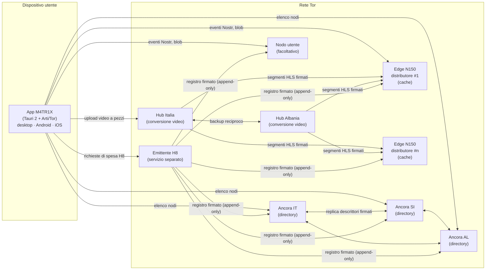
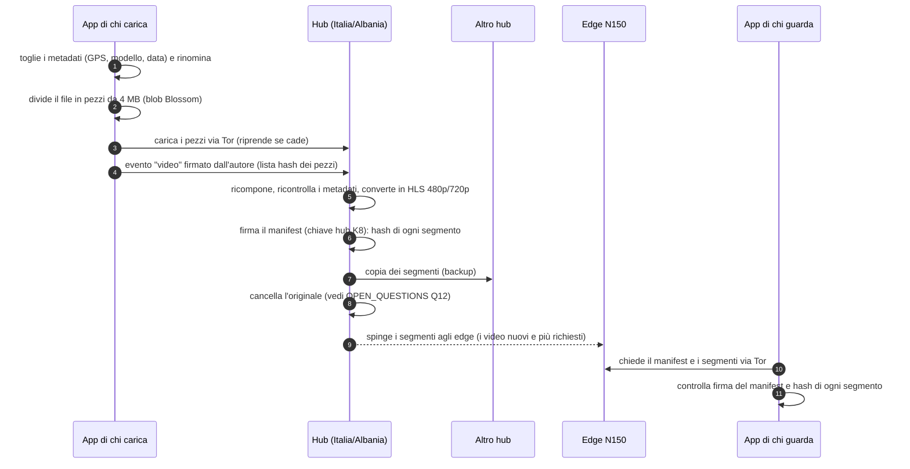

# M4TR1X v3 — Architettura

> Stato: **proposta, Fase 1** (solo documenti). Nessun codice è stato scritto.
> Fonti: `AUDIT_M4TR1X.md` (11/09/2026), correzioni del 15/10/2026 sui 4 repo, codice attuale.
> Ogni scelta importante ha un ADR in `decisions/`. Le decisioni che spettano al fondatore sono in `OPEN_QUESTIONS.md`.

---

## 0. In una frase

M4TR1X v3 è **una sola app** (desktop e mobile) che parla **un solo protocollo per funzione**, sempre **dentro Tor**, con una rete fatta di **un solo programma server** che può avere ruoli diversi (nodo utente, edge, hub, ancora), più **un servizio separato** che emette e registra H8.

Il perché, in breve: oggi ci sono 4 repo, 3 "gusci" per le app (Electron, Capacitor, Tauri), 2 head diversi, federazioni con Mastodon/PeerTube/Funkwhale, WebRTC, WebTorrent. Ognuna di queste cose è una porta in più da difendere. L'audit ha trovato i problemi gravi quasi tutti **nei punti dove due pezzi si parlano**. Meno pezzi = meno punti di contatto = meno buchi.

---

## 1. Componenti



Tutte le frecce passano da Tor. Nessun componente conosce l'IP di un altro.

### Responsabilità

| Componente | Cosa fa | Cosa NON fa | Chi lo gestisce |
|---|---|---|---|
| **App** | Chiavi dell'utente, interfaccia, cifratura DM, firma dei post e delle spese H8, pulizia dei metadati dai file, verifica di tutto ciò che riceve, aggiornamenti firmati | Non tiene niente in chiaro su disco. Non contatta mai un server fuori da Tor | Utente |
| **Nodo** (programma unico) | Relay Nostr + archivio blob (Blossom) + servizio onion. Il ruolo si sceglie in configurazione | Non conosce le chiavi private degli utenti. Non è in ascolto su interfacce di rete esterne | Chiunque |
| ↳ ruolo **nodo utente** | Ospita i contenuti di chi lo gestisce e di chi lo segue | — | Utente |
| ↳ ruolo **edge** (N150) | Cache dei segmenti video più richiesti e degli eventi recenti; accetta pagamenti H8 al distributore | Non converte video. Non è fidato: se viene rubato, rivela solo contenuti pubblici | H8-Group |
| ↳ ruolo **hub** | Riceve gli originali, li converte (HLS 480p/720p), firma i manifest, distribuisce agli edge, si fa backup con l'altro hub | Non conserva l'originale dopo la conversione (salvo scelta, vedi OPEN_QUESTIONS) | H8-Group |
| ↳ ruolo **ancora** | Conserva e replica la directory: descrittori firmati dei nodi e copia del registro H8 | Non decide chi entra (verifica solo le firme e le regole). Non è un head | Operatori nei 3 Paesi |
| **Emittente H8** | Unico che aggiunge righe al registro H8. Controlla saldo e numero di sequenza; firma | Non ospita contenuti. Non conosce l'identità Nostr di chi paga (vedi §6) | H8-Group |

**Perché un programma unico con ruoli e non quattro programmi.** Relay, archivio blob, Tor e directory servono a tutti i ruoli: cambia solo *quanto* e *cosa* conservano. Un solo programma vuol dire un solo codice da difendere, una sola serie di test e un solo aggiornamento. **Compromesso:** il programma contiene anche funzioni che su un certo ruolo restano spente (la conversione video su un nodo utente). Restano spente di default e un test lo verifica (invariante I-02).

---

## 2. Protocolli: uno per funzione

| Funzione | Scelta | Alternative scartate | Perché | Peso |
|---|---|---|---|---|
| Rete / trasporto | **Tor** (servizi onion v3). Server: `tor` in C. App: **Arti** (Tor in Rust) incorporato | I2P (rete più piccola, librerie mobili deboli); VPN (sposta la fiducia su un fornitore); Nym (giovane, a pagamento) | È l'unica rete anonima matura, con librerie mobili. Arti si incorpora nell'app senza processi esterni | Arti +8–12 MB per app |
| Post, profili, reazioni, follow | **Nostr** (NIP-01, eventi firmati) | ActivityPub (server-centrico, l'identità è del server, non dell'utente); Matrix (pesante, pensato per la chat) | Identità = chiave dell'utente, non account su un server. Un nodo che cade non porta via l'identità | Libreria piccola (`nostr-tools` lato server, parte minima lato app) |
| Messaggi privati | **NIP-17** (gift wrap NIP-59 + cifratura NIP-44) | NIP-04 (metadati in chiaro, cifratura debole); Signal/MLS (forward secrecy, ma con un server di consegna e molta complessità) | Nasconde il mittente, cifra bene, usa lo stesso protocollo dei post. **Compromesso:** niente forward secrecy (vedi §7) | Già implementato e testato il 15/10 |
| File e media | **Blossom** (blob indirizzati dall'hash SHA-256) | IPFS (pesante, DHT pubblica che espone chi chiede cosa); WebTorrent (P2P = IP dei visitatori visibili ai peer) | Il nome del file **è** il suo hash: qualsiasi nodo o edge può servirlo e l'app verifica che non sia stato alterato | Già presente nel nodo |
| Video | **HLS** a segmenti; ogni segmento è un blob Blossom | DASH (equivalente, meno supporto nativo nei player mobili); WebRTC (rivela l'IP, non passa da Tor) | Segmenti piccoli e indirizzati dall'hash: si mettono in cache sugli edge e si verificano uno per uno | ffmpeg solo sugli hub |
| Diretta | **Nessuna diretta in v3.0.** Eventuale "quasi-diretta" HLS via hub (20–40 s di ritardo) dopo | WebRTC (vedi sopra: incompatibile con la promessa) | Vedi ADR-0006 e OPEN_QUESTIONS Q6 | — |
| Directory dei nodi | **Descrittori firmati pubblicati come eventi Nostr sostituibili sulle 3 ancore** (§3) | DHT Kademlia; gossip firmato su protocollo nuovo | Riusa il protocollo che c'è già | Nessuna dipendenza nuova |
| Registro H8 | **Log append-only firmato dall'emittente**, replicato come file/eventi verificabili | Blockchain (consenso pesante, non serve: c'è un solo emittente per scelta); database condiviso (nessuna verifica indipendente) | Chiunque può verificare tutto il registro senza fidarsi di chi glielo passa (§6) | Libreria `@noble/post-quantum` (già usata) |
| Aggiornamenti | **Manifest firmato** (Ed25519, formato minisign) + hash dei pacchetti | Aggiornamento degli store (assenti per scelta); electron-updater (lega a Electron, firma solo del pacchetto) | Una sola chiave offline decide cosa è una release valida, indipendente dalla firma Android/Windows (§8) | Verifica in ~200 righe |
| Federazione con Mastodon / PeerTube / Funkwhale | **Tolta** | Ponti in sola lettura | Ogni ponte è un protocollo in più e fa uscire richieste verso server terzi (IP). ADR-0010 | −3 adattatori |
| P2P tra utenti (WebTorrent, tracker) | **Tolto** | — | Il P2P mostra l'IP dei visitatori agli altri peer | −1 protocollo |

---

## 3. Directory replicata

**Problema.** L'app deve sapere quali nodi, edge e hub esistono, con i loro indirizzi onion, senza un head centrale e senza che una sola macchina possa mentire o sparire.

**Cosa contiene un descrittore di nodo.** Chiave pubblica del nodo, indirizzo onion, ruoli, capacità (spazio, banda indicativa), versione del software, data di scadenza (7 giorni: chi non si rinnova sparisce da solo). **Mai IP, mai nomi, mai indirizzi H8.** Firmato con la chiave del nodo (K5 in `KEYS.md`).

### Confronto

| | DHT Kademlia | Relay Nostr come directory | Gossip firmato (protocollo nuovo) |
|---|---|---|---|
| Come funziona | Ogni nodo conserva una fetta della tabella; le ricerche saltano tra i nodi | Il nodo pubblica il proprio descrittore come evento firmato sostituibile sulle 3 ancore; le ancore se lo copiano a vicenda; l'app legge da tutte e 3 | I nodi si passano a catena l'elenco firmato |
| Resistenza a chi cade | Alta | Alta finché resta su almeno 1 ancora su 3 (e i nodi tengono una copia in cache) | Alta |
| Resistenza ai nodi falsi (Sybil) | **Bassa**: chi crea 1.000 nodi finti controlla zone della tabella e può far sparire o deviare le ricerche | Media: le ancore possono applicare regole d'ingresso (es. limiti per periodo, prova di lavoro, invito firmato) | Media |
| Complessità | Alta (routing, rinnovi, attacchi noti; su Tor ogni salto è lento) | **Bassa**: è il relay che c'è già, con un tipo di evento in più | Media-alta: protocollo nuovo da scrivere e difendere |
| Privacy di chi cerca | Bassa: chi sta sul percorso vede cosa cerchi | Buona: l'app scarica l'elenco intero (piccolo) e sceglie in locale | Buona |
| Protocolli nuovi | 1 | **0** | 1 |

### Scelta: relay Nostr sulle ancore (ADR-0003)

- **Perché.** Zero protocolli nuovi, codice già difeso (il relay è stato irrobustito il 15/10), e l'elenco completo è piccolo: anche con 10.000 nodi sono pochi MB, quindi l'app lo scarica tutto e nessuno sa a quale nodo si collegherà.
- **Compromesso.** Le 3 ancore sono "speciali": se cadono tutte e 3 insieme, i nodi nuovi non si trovano finché una torna (quelli già in cache sì). Non è un single point of failure (ne servono 3 giù insieme), ma è un punto *raro* di fallimento. Mitigazione: ogni nodo e ogni app tengono l'ultimo elenco valido; qualsiasi nodo può fare da ancora di riserva (stesso programma, ruolo diverso).
- **Regole che ogni ancora applica (e che l'app ricontrolla):** firma valida; nessun IP nel descrittore (solo `.onion` v3); scadenza ≤ 7 giorni; massimo 1 descrittore attivo per chiave di nodo; limite di nuove chiavi per giorno (anti-Sybil di base).
- **Le ancore non si fidano l'una dell'altra.** Si copiano solo eventi con firma valida: un'ancora compromessa può *nascondere* nodi (rimedio: l'app legge da tutte e 3 e unisce), non può *inventarli* senza le loro chiavi.

---

## 4. Flusso video end-to-end



**Anonimato di chi carica — cosa vede chi:**

| Chi | Vede | Non vede |
|---|---|---|
| Rete (ISP, Wi-Fi) | Che il telefono usa Tor; quanti byte | Che sta caricando su M4TR1X, cosa, dove |
| Hub | Il video (pulito), la chiave pubblica dell'autore, l'ora | IP, posizione, modello del telefono |
| Edge, nodi, chi guarda | Il video convertito, l'autore (chiave pubblica) | Tutto il resto |
| Stato con visione globale della rete | Può tentare di correlare i tempi (inizio/fine upload ↔ traffico Tor del telefono) | — **non promesso**, vedi `THREAT_MODEL.md` |

**Perché la pulizia dei metadati avviene sul telefono e non solo sull'hub.** Se la facesse solo l'hub, l'hub vedrebbe il GPS. Si fa su entrambi: il telefono come difesa principale, l'hub come seconda (e un test verifica che un file con GPS di prova esca pulito — I-16).

**Compromesso dei pezzi da 4 MB.** Su Tor un upload lungo cade spesso: senza pezzi si ricomincia da capo. Il costo è un evento in più (l'elenco dei pezzi).

---

## 5. Identità

**Cos'è.** Una coppia di chiavi Nostr (secp256k1/Schnorr). La chiave pubblica è il "nome" dell'utente nella rete. Non ci sono account, email o numeri di telefono.

| Fase | Come | Perché / compromesso |
|---|---|---|
| **Generazione** | Sul dispositivo, da un **seme di 24 parole** (BIP-39). Dal seme si ricavano chiavi diverse per ruoli diversi con etichette diverse (HKDF): `m4tr1x/identity/v1`, `m4tr1x/wallet/v1` | Un solo backup per l'utente, ma chiavi separate: chi ruba la firma di un post non ha la chiave del wallet. **Compromesso:** chi ruba il **seme** ha tutto, ed è per questo che il seme non sta mai sul dispositivo in chiaro |
| **Conservazione** | Chiavi cifrate a riposo: portachiavi del sistema (Android Keystore, iOS Keychain, Windows DPAPI, macOS Keychain); in mancanza, passphrase + scrypt (N=2^17, incluso in Node: nessuna dipendenza in più; Argon2id quando sarà disponibile nativamente) | Oggi il nodo salva la password dell'identità in un file accanto alla chiave (M2 dell'audit): non si ripete |
| **Backup** | Le 24 parole su carta. Facoltativo: backup cifrato con la passphrase sul proprio nodo | Niente backup "nel cloud di qualcuno" |
| **Recupero** | Solo con il seme. Senza seme l'identità è persa | Nessun custode = nessuno che possa essere costretto a consegnarla. Il recupero "sociale" è in OPEN_QUESTIONS Q11 |
| **Rotazione** | Evento "migrazione" firmato **dalla chiave vecchia** che indica la nuova; l'app di chi ti segue lo segue in automatico | Serve quando la chiave è sospetta ma ancora in mano tua |
| **Revoca** | Evento "revoca" firmato con una **chiave di revoca** ricavata dal seme (`m4tr1x/revoke/v1`) e mai tenuta sul dispositivo | Se il telefono viene rubato, dal seme puoi dichiarare morta la chiave vecchia anche se il ladro ce l'ha. Il ladro non può revocare te: non ha il seme |

**Più dispositivi.** v3.0: lo stesso seme su più dispositivi. In seguito si potranno valutare chiavi per dispositivo delegate dalla principale (non in v3.0: aggiunge un protocollo).

---

## 6. Registro H8

### Le regole decise (e un punto da chiarire)

- Non convertibile in euro; si spende solo nell'ecosistema; niente blockchain né consenso distribuito; nessun indirizzo H8 nei post.
- **Mance (deciso 15/10/2026):** solo verso conti creator, divise nello split; nessun trasferimento libero tra utenti (I-34). Quota del nodo: OPEN_QUESTIONS Q16.
- **Acquisto (deciso 15/10/2026):** bonifico SEPA manuale a 1,25 €/H8 → buono → riscatto via Tor; buoni a firma cieca prima della vendita reale; niente vendita prima del parere legale (ADR-0015).

### Schema di una riga del registro

```
riga {
  rete:        "m4tr1x-main"        // separa la rete vera da quella di prova
  indice:      n                    // 1, 2, 3, … senza buchi
  prec:        sha256(riga n-1)     // catena: nessuna riga si può togliere o cambiare
  tipo:        conio | riscatto_buono | spesa | mancia | rimborso | ricodifica_conto
               // nessun "trasferimento": utente → utente non esiste (I-34)
  da:          id_conto | "EMITTENTE"
  a:           id_conto | id_esercente
  importo:     intero (centesimi di H8)
  seq_conto:   numero di sequenza del pagante (1, 2, 3, …)
  autorizz:    firma del pagante (chiave wallet K2) su {rete, tipo, da, a, importo, seq_conto, scadenza}
  ts:          data
  firma_op:    firma dell'emittente operativo (K10) su tutta la riga
  cert_op:     riferimento al certificato di K10 firmato dalla radice (K9)
  firma_radice: solo per "conio": firma della radice (K9)
}
```

- **`id_conto`** è un numero casuale, **non** la chiave Nostr e **non** derivabile da essa (I-14). Chi guarda il registro vede importi e conti, ma non chi sono.
- Tutte le firme portano un'etichetta di dominio (`m4tr1x/h8/spend/v1`, ecc.), così una firma fatta per un'altra cosa non vale qui (I-08).

### Chi firma cosa

| Azione | Firma | Perché |
|---|---|---|
| Creare H8 ("conio") | **Radice dell'emittente (K9), offline** | Il denaro che nasce deve passare da una chiave che non sta mai su un server |
| Autorizzare una spesa | **Wallet dell'utente (K2)** | Nessuno, nemmeno l'emittente, può spendere al posto tuo |
| Mettere in ordine e pubblicare la riga | **Emittente operativo (K10), online** | Serve un firmatario sempre acceso per la doppia spesa (sotto). K10 **non** può creare H8 né spendere al posto degli utenti: può solo ordinare, o rifiutare |
| Certificare K10 | K9, una volta, con scadenza (es. 90 giorni) | Se K10 viene rubata, scade da sola e la si sostituisce senza toccare K9 |

### Verifica e replica

Ogni nodo, edge e ancora tiene una copia del registro e la verifica da zero: catena degli hash, firme, certificato di K10, autorizzazione dell'utente, saldo mai negativo, conservazione (somma dei saldi = somma dei coni − rimborsi, I-11). Le copie si confrontano pubblicando periodicamente la **testa firmata** (indice + hash). Se l'emittente mostra a due copie due righe diverse con lo stesso indice, la prova è la coppia di teste firmate: le repliche smettono di accettare righe nuove e danno l'allarme (I-13).

### Doppia spesa

C'è un solo emittente che ordina e ogni conto ha un **numero di sequenza**: la spesa n. 7 del conto X si accetta una volta sola (I-12). Niente gara tra nodi, perché i nodi non scrivono il registro: lo leggono e basta. È esattamente il buco dell'architettura attuale (C4: ogni nodo un registro suo) che sparisce.

### Funzionamento offline (distributori)

- L'emittente è online per le spese normali. Se non è raggiungibile, l'app mette la spesa in coda e la manda dopo: niente spesa "fatta a metà".
- **Distributore senza rete:** l'edge accetta un **buono offline** firmato dal wallet, **fino a un tetto per conto e per giorno** (es. 5 H8). Quando torna la rete, l'edge consegna i buoni all'emittente. Se nel frattempo lo stesso conto ha speso altrove, il danno massimo è il tetto (rischio accettato e piccolo).

### La contestazione onesta

La decisione "niente head centrale" vale per **contenuti e directory**. Per H8, invece, **l'emittente è centrale per scelta** (è quello che permette di evitare la blockchain). Quindi:
- se l'emittente cade, **i social funzionano lo stesso**, il registro resta leggibile ovunque, ma **non si spendono H8 nuovi** (solo buoni offline entro il tetto);
- l'emittente **può censurare** una spesa (rifiutarla), **non può rubare** (non ha K2) **né creare H8 di nascosto** (non ha K9 online, e le repliche controllano la conservazione).

Mitigazione: emittente su due macchine (una attiva, una di riserva, con la stessa K10 o con una K10 propria certificata). È un compromesso esplicito con il principio 3: **lo dichiaro, non lo nascondo**.

### Come una mancia arriva al creator senza indirizzo nel post

Il creator registra **in privato presso l'emittente** "la mia chiave Nostr → il mio conto". Chi manda la mancia indica la chiave Nostr del creator; l'emittente la traduce in `id_conto`. Il pubblico non vede il collegamento; **l'emittente sì** (rischio residuo dichiarato nel THREAT_MODEL).

---

## 7. Messaggi privati

- **Formato:** NIP-17. Il messaggio (kind 14, non firmato) viene sigillato (kind 13, firmato dal mittente, cifrato NIP-44 per il destinatario) e imbustato (kind 1059, firmato da una **chiave usa e getta**, data sfalsata fino a 2 giorni). Una busta per il destinatario e una per il mittente (la sua copia).
- **Dove vanno:** ai relay che il destinatario dichiara per i DM (un evento "i miei relay per i DM"), via Tor.

| Metadato | Visibile a | Nascosto a |
|---|---|---|
| Contenuto | solo mittente e destinatario | tutti gli altri |
| Mittente | solo il destinatario | relay, rete, chiunque legga il relay |
| Destinatario | **il relay** (tag `p` della busta, serve per consegnarla) | rete (Tor) |
| Ora esatta | mittente e destinatario | il relay vede un'ora sfalsata |
| Dimensione | il relay (approssimata) | — |
| IP | nessuno (Tor) | — |

**Non promesso:** forward secrecy. Se un giorno la chiave identità viene rubata, chi ha conservato le buste può leggere anche i messaggi vecchi. Rimedio parziale: una chiave DM separata (`m4tr1x/dm/v1`) che si ruota spesso, annunciata dall'identità. Una cifratura con ratchet tipo Signal è un progetto a sé: fuori dalla v3.0.

---

## 8. Aggiornamenti

| Passo | Come |
|---|---|
| Build | In CI, da un tag, con le versioni bloccate dai lockfile. Due build indipendenti dello stesso tag devono dare lo stesso hash (dove la piattaforma lo permette, vedi sotto) |
| Firma | Il fondatore firma **offline** un `release.json` (versione, numero di sequenza, data, hash SHA-256 di ogni pacchetto, versione minima ammessa) con la **chiave release K11** (Ed25519, formato minisign) |
| Distribuzione | `release.json` + pacchetti come blob Blossom sugli hub/edge (via Tor) e come copia su nderja.com |
| Verifica nell'app | L'app ha la chiave pubblica K11 incorporata. Scarica `release.json` via Tor, verifica la firma, verifica l'hash del pacchetto e solo allora propone l'installazione |
| Rollback | L'app rifiuta una versione **più vecchia** di quella installata, e un `release.json` con numero di sequenza **più basso** dell'ultimo visto (così nessuno può rimandarti a una versione bucata). Per tornare indietro di proposito si pubblica una nuova release con numero più alto che contiene il codice vecchio |
| Doppia chiave su Android | L'APK è firmato con la keystore Android (K12) **e** il suo hash è nel `release.json` firmato con K11: per un aggiornamento malevolo servono entrambe le chiavi rubate |
| Nodi server | Stesso `release.json`; l'operatore lancia `m4tr1x update`, che verifica prima di installare |

**Build riproducibili — onestamente.** Il codice Rust e il frontend si possono rendere riproducibili. L'APK Android si può verificare confrontando il contenuto senza la firma. Installer Windows e macOS non sono completamente riproducibili (firme, timestamp): per quelli si promette "hash pubblicati e build doppia in CI", non la riproducibilità bit per bit.

---

## 9. Scelte trasversali

- **Sicuro di default:** il nodo ascolta solo su `127.0.0.1` e sull'onion; l'admin solo in locale con la sua chiave (K13); l'app non ha permessi che non usa.
- **Un solo linguaggio lato server:** JavaScript (Node.js) con controllo dei tipi `// @ts-check`, così si riusa il codice attuale (ADR-0012). Rust solo nel guscio dell'app (Tauri + Arti).
- **Un solo database:** SQLite ovunque. Postgres (repo head) esce di scena (ADR-0011).
- **Un solo guscio per le app:** Tauri 2, per desktop, Android e iOS (ADR-0002). Escono Electron e Capacitor.
- **Ogni regola di sicurezza ha un test:** `SECURITY_INVARIANTS.md`.
