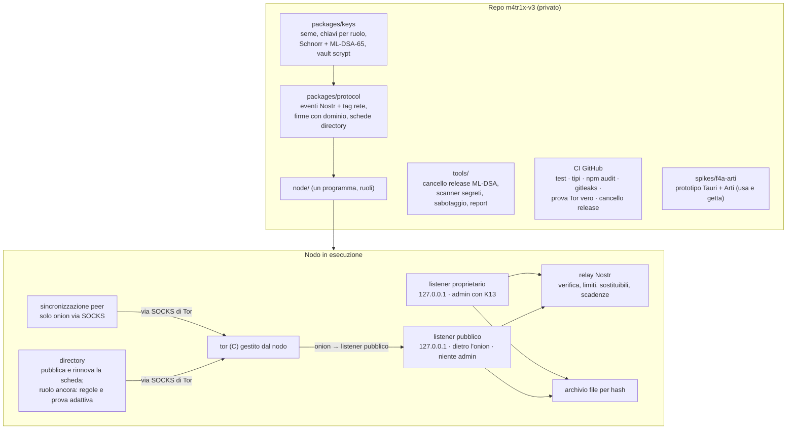

# Stato di M4TR1X v3

> Scritto per il fondatore, in italiano semplice. **Fonte di verità: il codice e i test**, non i documenti di progetto. Dove divergono, è segnalato con ⚠.
> Le parti tra i marcatori `AUTO` si rigenerano con **`npm run report`** (stato delle regole, test, dipendenze); l'esito delle prove di sabotaggio con **`npm run sabotage`**. Il resto è scritto a mano: data dell'ultima revisione **15/10/2026**.
> Regola di questo documento: niente ottimismo. Ciò che non è verificato da un test è scritto come "non verificato".

## In una riga

Oggi esistono **le fondamenta** (CI, chiavi, protocollo, nodo server, directory). **Non esiste ancora niente che un utente possa usare**: nessuna app, nessun messaggio privato, nessun video, nessun H8. Tutto ciò che c'è è verificato da test, quasi tutto anche da prove di sabotaggio; niente è stato provato su un telefono né tra nodi lontani.

---

## 1. Funzioni

Stati: **fatta** (codice + test), **in corso** (una parte c'è), **prevista** (nel piano, niente codice), **rimandata** (fuori dalla v3.0), **non pianificata** (nessun piano).

| Funzione | Stato | Fase | Come funziona (o funzionerà) |
|---|---|---|---|
| Post | **in corso** | F1–F2 fatte, F4 app | Il protocollo firma e verifica i post (eventi Nostr con tag di rete, senza dati H8) e il relay del nodo li salva e li distribuisce. **Non c'è un'app per scriverli o leggerli.** |
| Messaggi privati | prevista | F5 | NIP-17 (busta cifrata, mittente nascosto). ⚠ Nei documenti risulta "già implementato il 15/10": era nel **vecchio** nodo v2; in v3 **non c'è codice**. Esiste solo la chiave DM ricavata dal seme. |
| Reels (video brevi) | prevista | F6 | Come i video lunghi, stessa pipeline. Nessun piano specifico per i reels. |
| Video lunghi | in corso (solo archivio) | F6 | Oggi il nodo archivia file per hash e li replica tra nodi verificandoli. Mancano upload a pezzi, pulizia metadati sul dispositivo, conversione HLS sugli hub, cache sugli edge. |
| Musica | **non pianificata** | — | ⚠ Il v2 aveva musica (con Funkwhale, tolto da ADR-0010). Nei documenti v3 la musica non compare: decisione da prendere (sezione 10). |
| Topic / forum | **non pianificata** | — | ⚠ Il v2 aveva i forum. Nei documenti v3 non compaiono: decisione da prendere. |
| Mance | prevista | F7 | Solo verso creator, divise nello split (50/30/20), quota nodo al fondo nodi. Registro firmato dall'emittente. Nessun codice. |
| Shop | prevista (solo acquisto H8) | F7b | Acquisto H8 con bonifico SEPA → buono a firma cieca. Uno shop di oggetti fisici **non è progettato**. Vendita reale solo dopo parere legale. |
| Boost | prevista, non progettata | F7 | Citato come spesa verso H8-Group; nessun dettaglio su come un boost cambia la visibilità. |
| Distributori | prevista | F10 | Edge N150 con cache e pagamento H8, buoni offline entro un tetto. Nessun codice. |
| Nodo personale | **in corso** | F2 fatta | Il programma `node` (ruolo user) gira: relay, archivio file, Tor con onion proprio, sincronizzazione con peer onion. **Manca:** installer, aggiornamenti firmati del nodo, chiave del nodo cifrata, gestione di quale contenuto replicare. |
| Modalità discreta | prevista (da confermare) | F9 | Icona e nome neutri, apertura con PIN. Solo una raccomandazione (Q14). |
| Identità | **in corso** | F1 fatta | 24 parole → chiavi separate per ruolo; vault cifrato (scrypt N=2^17). **Manca:** app, portachiavi del sistema, flussi di rotazione e revoca (esistono solo i "domini" di firma), più dispositivi. |
| Aggiornamenti | in corso | F0 + ADR-0017 fatti, F8 | Il cancello della CI rifiuta release senza manifest firmato ML-DSA-65. **Manca:** cerimonia delle chiavi (nessuna chiave di release esiste), updater nell'app e nel nodo, anti-rollback, build riproducibili. |
| Rilevatore AI | rimandata | — (Q13) | Fuori dalla v3.0; eventualmente sugli hub più avanti. |
| Dirette | rimandata | — (ADR-0006, Q6) | WebRTC è incompatibile con Tor; forse "quasi-diretta" HLS dopo la v3.0. |

---

## 2. Protocolli

| Funzione | Protocollo | Perché | Scartato | Nel codice oggi? |
|---|---|---|---|---|
| Trasporto | Tor (onion v3): `tor` sui server; nelle app Arti, o `tor` su Windows (ADR-0016) | unica rete anonima matura | I2P, VPN, Nym | **Server sì** (`node/src/tor.js`, provato su Tor vero). **App no.** |
| Post, profili | Nostr NIP-01 + tag `net` obbligatorio | identità dell'utente, non del server | ActivityPub, Matrix | **Sì** (`packages/protocol`) |
| Eventi sostituibili / scadenza | NIP-33, NIP-40 | una scheda per nodo; i nodi morti spariscono | — | **Sì** (relay) |
| Prova di lavoro | NIP-13, adattiva | anti-spam sulle ancore senza tetti consumabili | tetto fisso di chiavi nuove | **Sì** (directory) |
| Directory | schede firmate su relay delle 3 ancore | zero protocolli nuovi | DHT Kademlia, gossip | **Sì** (`node/src/directory.js`) |
| File | Blossom (hash SHA-256), autorizzazione kind 24242 | verificabile da chiunque | IPFS, WebTorrent | **Sì** (`node/src/blobs.js`) |
| Messaggi privati | NIP-17 (NIP-59 + NIP-44) | mittente nascosto | NIP-04, Signal/MLS | **No** (F5) |
| Video | HLS a segmenti come blob | cache e verifica per segmento | DASH, WebRTC | **No** (F6) |
| Registro H8 | log append-only firmato dall'emittente | niente blockchain | blockchain, DB condiviso | **No** (F7) |
| Acquisto H8 anonimo | buoni RSA a firma cieca (RFC 9474) | l'emittente non collega bonifico e conto | accredito diretto | **No** (F7b) |
| Aggiornamenti | manifest firmato ML-DSA-65 | post-quantum, chiave offline | minisign/Ed25519, store | **Solo il cancello CI** |
| Database | SQLite incluso in Node (`node:sqlite`), Node fissato a 22.23.3 | nessuna dipendenza nativa | better-sqlite3, Postgres | **Sì** |

---

## 3. Crittografia

Regola (ADR-0017): **Schnorr** per il social, **ML-DSA-65** (anti-quantistico) per ciò che vale. Ed25519 solo dentro Tor, RSA solo nel modulo buoni.

| Chiave | Algoritmo | Ruolo | Dove vive | Anti-quantistica | Nel codice oggi |
|---|---|---|---|---|---|
| K0 seme | BIP-39 (24 parole) → HKDF-SHA256 | backup dell'utente | carta | n/a | **Sì** |
| K1 identità | Schnorr secp256k1 | firma post e profilo | vault scrypt (portachiavi del sistema: F4) | **No** | **Sì** |
| K1d DM | secp256k1 (NIP-44) | ricevere messaggi | come K1 | **No** | ricavata, **mai usata** (F5) |
| K1r revoca | Schnorr secp256k1 | revocare l'identità | solo dal seme | **No** | ricavata, **nessun flusso di revoca** |
| K2 wallet | **ML-DSA-65** | autorizzare spese H8 | come K1 | **Sì** | **Sì**, usata solo nei test (niente registro) |
| K5 nodo | Schnorr secp256k1 | firma la scheda di directory | file `node.key`, permessi 600 | **No** | **Sì**, ⚠ **non cifrata** (KEYS.md dice "cifrata": non è vero oggi) |
| K6 onion | Ed25519 | indirizzo onion | cartella di Tor | **No** | **Sì** (la crea Tor) |
| K7 ancora | Schnorr secp256k1 | firma istantanee della directory | disco dell'ancora | **No** | ⚠ **non esiste**: l'ancora usa K5; istantanee non implementate |
| K8 hub | Schnorr secp256k1 | firma manifest video | disco dell'hub | **No** | No (F6) |
| K9 radice emittente | **ML-DSA-65** | conio, certificati | offline | **Sì** | ruolo previsto in `keys`, **nessun permesso né codice** (F7) |
| K10 emittente operativo | **ML-DSA-65** | firma righe del registro | server emittente | **Sì** | come K9 |
| K11 release | **ML-DSA-65** | firma `release.json` | offline | **Sì** | strumenti pronti; **chiave mai generata** (cerimonia da fare) |
| K12 keystore Android | RSA/EC (imposto da Android) | firma APK | offline | **No** | No |
| K13 admin nodo | token casuale 256 bit | API admin locale | file `admin.key`, permessi 600 | n/a | **Sì** |
| K14 pagamenti | — | non serve (SEPA manuale) | — | — | — |
| K15 buoni ciechi | RSA-PSS 3072 (RFC 9474) | buoni anonimi | server emittente | **No** | No (F7b) |

---

## 4. Architettura (ciò che esiste davvero oggi)

**Non esiste ancora:** app (desktop e mobile), modulo `transport`, hub, edge, emittente H8 (`m4tr1x-issuer`), updater, ancore reali in rete. Le 3 ancore e i nodi esistono **solo nei test**, sulla stessa macchina.

---

## 5. Difese (regole I-xx)

<!-- AUTO:REGOLE:INIZIO -->
_Generato da `npm run report` il 2026-10-15. Fonte: il codice dei test (`tests/invariants/`), confrontato con `docs/SECURITY_INVARIANTS.md`._

**20 regole attive, 20 in attesa, 0 assenti.** Prove di sabotaggio: 37/37 prese, eseguite il 2026-10-15 (Node 22.23.3, win32 10.0.26200).

| Regola | Cosa garantisce | Stato | Fase | Test | Sabotaggio |
|---|---|---|---|---|---|
| I-01 | Nessuna richiesta di rete delle app esce fuori da Tor. | in attesa | F4 | — | — |
| I-02 | Il nodo è in ascolto solo su loopback | attiva | F2 | `inv-02-bind.test.js` ✅ 3 verdi | 1/1 prese |
| I-03 | Il nodo rifiuta richieste con Host non ammesso | attiva | F2 | `inv-03-host.test.js` ✅ 7 verdi | 1/1 prese |
| I-04 | Nessun Access-Control-Allow-Origin: * | attiva | F2 | `inv-04-cors.test.js` ✅ 10 verdi | 1/1 prese |
| I-05 | Il nodo non contatta mai un peer che non sia .onion | attiva | F3 | `inv-05-onion-only.test.js` ✅ 3 verdi | 2/2 prese |
| I-06 | Nessuna chiave privata finisce su disco in chiaro. | attiva | F1 | `inv-06-keys-at-rest.test.js` ✅ 5 verdi | 2/2 prese |
| I-07 | Ruoli separati: una firma fatta con la chiave di un ruolo viene rifiutata dove serve un altro ruolo | attiva | F1 | `inv-07-role-separation.test.js` ✅ 7 verdi | 2/2 prese |
| I-08 | Ogni firma ha un'etichetta di dominio e l'identificativo di rete | attiva | F1 | `inv-08-domain-sep.test.js` ✅ 5 verdi | 1/1 prese |
| I-09 | Un conio senza firma della radice dell'emittente (K9) viene rifiutato | in attesa | F7 | — | — |
| I-10 | Una spesa senza l'autorizzazione del wallet del pagante viene rifiutata | in attesa | F7 | — | — |
| I-11 | Conservazione: somma dei saldi = somma dei coni − rimborsi; nessun saldo negativo, dopo qualsiasi sequenza | in attesa | F7 | — | — |
| I-12 | Doppia spesa impossibile: due spese con lo stesso seq_conto → la seconda è rifiutata | in attesa | F7 | — | — |
| I-13 | Equivocazione scoperta: se l'emittente firma due righe diverse con lo stesso indice, la replica si ferma e dà l'allarme | in attesa | F7 | — | — |
| I-14 | I conti H8 non sono collegabili alle chiavi Nostr | in attesa | F7 | — | — |
| I-15 | Nessun indirizzo o conto H8 in un evento Nostr pubblicato. | attiva | F1 | `inv-15-no-h8-in-events.test.js` ✅ 9 verdi | 1/1 prese |
| I-16 | Nessun metadato identificativo lascia il dispositivo | in attesa | F6 | — | — |
| I-17 | Un blob si accetta solo se il suo SHA-256 corrisponde. | attiva | F2 | `inv-17-blob-hash.test.js` ✅ 4 verdi | 2/2 prese |
| I-18 | Hub, edge e nodi non scrivono indirizzi IP nei log. | attiva | F2 | `inv-18-no-ip-logs.test.js` ✅ 1 verdi | 1/1 prese |
| I-19 | I DM escono solo come gift wrap (kind 1059). | in attesa | F5 | — | — |
| I-20 | La busta è firmata da una chiave usa e getta e ha data sfalsata. | in attesa | F5 | — | — |
| I-21 | L'app rifiuta un aggiornamento con firma non valida | in attesa | F8 | — | — |
| I-22 | Niente rollback: versione più bassa o seq del manifest più basso dell'ultimo visto → rifiutato | in attesa | F8 | — | — |
| I-23 | La CI non pubblica release senza manifest firmato valido | attiva | F0 | `inv-23-release-gate.test.js` ✅ 10 verdi | 2/2 prese |
| I-24 | Build riproducibile (dove possibile): due build dello stesso tag danno gli stessi hash per frontend, binari Rust e contenuto dell'APK | in attesa | F8 | — | — |
| I-25 | Nessuna dipendenza con vulnerabilità alte o critiche; lockfile bloccati; pacchetti vietati assenti. | attiva | F0 | `inv-25-deps.test.js` ✅ 2 verdi | 1/1 prese |
| I-26 | Un input malformato non fa cadere il nodo | attiva | F2 | `inv-26-fuzz.test.js` ✅ 1 verdi | 1/1 prese |
| I-27 | Ogni processo esterno (ffmpeg, exiftool) ha un timeout | in attesa | F6 | — | — |
| I-28 | Nessun segreto nel repo (chiavi, .env, .db, chiavi onion, IP, email personali) | attiva | F0 | `inv-28-secrets.test.js` ✅ 19 verdi | 2/2 prese |
| I-29 | I descrittori della directory contengono solo onion v3 | attiva | F3 | `inv-29-descriptor.test.js` ✅ 7 verdi | 3/3 prese |
| I-30 | L'indirizzo onion di un nodo utente è visibile solo al suo proprietario | attiva | F2 | `inv-30-33-admin-onion.test.js` ✅ 7 verdi | 1/1 prese |
| I-31 | Nessuna chiave privata utente raggiunge il codice JavaScript dell'app; | in attesa | F4 | — | — |
| I-32 | Buoni offline entro il tetto: un edge non accetta più del tetto giornaliero per conto, anche offline | in attesa | F10 | — | — |
| I-33 | L'admin del nodo è raggiungibile solo da loopback con la chiave admin (K13) | attiva | F2 | `inv-30-33-admin-onion.test.js` ✅ 7 verdi | 1/1 prese |
| I-34 | Nessun trasferimento tra utenti: | in attesa | F7 | — | — |
| I-35 | Buono cieco: l'emittente non può collegare un buono riscattato al bonifico che l'ha pagato | in attesa | F7b | — | — |
| I-36 | Trasporto unico: solo il modulo transport dell'app apre connessioni di rete, e accetta solo onion v3 validati (ADR-0016) | in attesa | F4 | — | — |
| I-37 | Il Tor di Windows è solo dell'app: | in attesa | F4 | — | — |
| I-38 | Le schede della directory scadono e si rinnovano: | attiva | F3 | `inv-38-expiry.test.js` ✅ 5 verdi | 4/4 prese |
| I-39 | Limiti sulle ancore senza porte chiudibili: | attiva | F3 | `inv-39-anchor-limits.test.js` ✅ 7 verdi | 5/5 prese |
| I-40 | Due famiglie di firme (ADR-0017): | attiva | F1 | `inv-40-signature-families.test.js` ✅ 6 verdi | 3/3 prese |

**Divergenze tra documento e codice:** nessuna trovata.
<!-- AUTO:REGOLE:FINE -->

**Note scritte a mano sulle prove di sabotaggio:**
- Alcune regole hanno **due strati di difesa**; un sabotaggio che toglie solo uno strato non fa fallire il test (la difesa regge). È successo per I-26 (messaggi malformati: protezione interna ed esterna), I-05 (parser + agente Tor che rifiuta i non-onion) e "l'ancora accetta solo schede" (filtro sul tipo + verifica della scheda). Per I-26 e I-05 il sabotaggio salvato toglie **tutte** le difese o colpisce lo strato con un test diretto.
- Una prova "presa" dimostra che il test si accorge di **quella** rottura, non di tutte quelle possibili.

---

## 6. Minacce: chi è protetto da cosa

**Oggi nessun utente è protetto, perché non esiste un'app.** Le difese seguenti valgono per chi gestisce un **nodo** e per i dati che il nodo tratta.

| Contro | Protetto (verificato da test) | NON protetto |
|---|---|---|
| Sito web malevolo | il nodo non risponde a Host estranei (DNS rebinding) né a origini CORS non configurate; admin solo locale con chiave | — (lato app: niente da proteggere, l'app non c'è) |
| Nodo ostile | eventi e file verificati (firma, hash); frame malformati non fanno cadere il nodo; schede false rifiutate | **spam di eventi validi**: nessun limite di spazio per gli eventi; un nodo scarica tutto ciò che i peer gli mandano |
| Osservatore di rete | il nodo contatta solo onion via Tor; nessun IP nelle schede né nei log | che il nodo usi Tor resta visibile (nessun bridge configurato) |
| Stato | come sopra | correlazione temporale globale (mai promessa); sequestro del server: chiave del nodo e chiave admin **in chiaro** sul disco |
| Ladro del dispositivo | vault scrypt per le chiavi utente (solo libreria) | nessuna app, nessun blocco con PIN, nessun portachiavi del sistema |
| Insider (operatore di ancora) | un'ancora non può inventare nodi; l'unione lato client compensa un'ancora che nasconde | un'ancora compromessa può **riempire le altre** fino al tetto (le schede tra ancore saltano i limiti di frequenza) |
| Computer quantistico | wallet e release in ML-DSA-65 (libreria e test) | identità e social in Schnorr (scelta voluta: Nostr) |

Cosa M4TR1X non promette: vedi `THREAT_MODEL.md` §5 (resta valido).

---

## 7. Debolezze note e debiti tecnici (dal più grave)

1. **Nessuna app**: tutto il valore per l'utente è ancora da costruire (F4–F9).
2. **Arti non regge su Windows** (diagnosi completa, causa interna non trovata) e **non è stato provato su un telefono**: la scelta Tauri + Arti per il mobile non è confermata.
3. **Chiavi del nodo e admin in chiaro** su disco (K5, K13): chi prende il disco impersona il nodo.
4. **Nessun limite di spazio per gli eventi** nel relay, e **sincronizzazione senza filtro** tra peer: un peer può riempire un nodo di eventi validi.
5. **Le ancore si fidano delle altre ancore** per la frequenza: un'ancora compromessa può riempire le altre fino al tetto di 10.000 schede.
6. **Registro H8 inesistente**: mance, shop, distributori non si possono provare.
7. **Il sito nderja.com dice cose non vere su v3**: identità "ML-DSA-65", "tutto il codice è pubblico" (i repo sono privati), link di download di Kalendae rotto.
8. **Repo v2 privati ma con segreti nella storia** (`h8identity.enc` nei tag, email personale, onion del nodo alpha): chi li ha copiati quando erano pubblici li conserva. Rotazione della chiave mai fatta.
9. **Nessuna istantanea firmata delle ancore (K7)**: il confronto tra ancore previsto nei documenti non esiste.
10. **Prova di lavoro in JavaScript**: 18 bit ≈ 1 s su un PC, su un N150 probabilmente molto di più (non misurato).
11. **`node:sqlite` sperimentale**: mitigato fissando Node 22.23.3 e testando le funzioni usate.
12. **Controllo dei tipi non rigoroso** (`strict: false`).
13. **Il commento in testa a `node/src/node.js`** dice "anchor dalle fasi successive" ma il ruolo ancora c'è: piccolo, ma è un documento sbagliato.
14. **Nessun limite all'archivio file oltre la quota per chiave**; nessuna pulizia dei file non più citati.

---

## 8. Cose non verificate

| Cosa | Perché non è verificato | Cosa serve |
|---|---|---|
| App su telefono Android (Arti) | nessun telefono Android disponibile | un telefono Android, anche in prestito |
| Arti su Windows | si blocca al consenso (sezione 11) | nuove versioni di Arti; intanto `tor` su Windows (ADR-0016) |
| macOS e iOS | nessun Mac | un Mac (per compilare e firmare iOS) |
| Nodi lontani (latenza, banda reali) | tutte le prove con più nodi girano sulla stessa macchina | almeno 2 nodi in luoghi diversi (es. Robecco e Albania) |
| Ancore reali in 3 Paesi | nessuna ancora in rete | 3 macchine e i loro responsabili (Q8) |
| Audit esterno | mai fatto | una revisione indipendente prima del lancio |
| Installer desktop, build riproducibili | non ancora costruiti (F8) | fase F8 |
| Prestazioni su N150 | mai misurate | un N150 |
| Interfaccia (usabilità, accessibilità) | non esiste | F4 |

---

## 9. Avanzamento

| Fase | Stato | Note |
|---|---|---|
| F0 Fondamenta | **chiusa** | CI, scanner, cancello release (poi passato a ML-DSA) |
| F1 Protocollo e chiavi | **chiusa** | + ADR-0017 (due famiglie di firme) |
| F2 Nodo base | **chiusa** | prova via Tor vero passata in locale e in CI |
| F3 Directory | **chiusa** | scadenza, limiti, prova di lavoro adattiva |
| F4a Prototipo Tauri + Arti | **aperta, bloccata** | desktop Windows: Arti non regge; telefono: nessun dispositivo; APK: passo Gradle da sistemare |
| F4 App base (desktop) | mancante | 8–12 giornate (stima del piano) |
| F5 Messaggi privati | mancante | ~2 giornate (codice v2 da riportare) |
| F6 Video | mancante | 5–7 giornate |
| F7 H8 | mancante | 5–8 giornate |
| F7b Buoni ciechi | mancante | 2–3 giornate + parere legale |
| F8 Aggiornamenti e release | mancante | 3–4 giornate + cerimonia delle chiavi |
| F9 Mobile | mancante | dipende da F4a |
| F10 Distributori | mancante | 2–3 giornate |
| F11 Lancio controllato | mancante | dipende da ancore reali, audit, parere legale |

**Onestà sulle stime:** il piano stimava ~40–52 giornate in totale. F0–F3 sono state fatte in una giornata intensa con Claude, ma sono le fasi con meno incognite. Le fasi rimanenti contengono le parti più rischiose (Rust, mobile, emittente) e dipendenze esterne (telefono, legale, persone per le ancore): **restano ~30–45 giornate di lavoro, più i tempi esterni**, che non dipendono da noi.

---

## 10. Decisioni ancora aperte

| # | Decisione | Raccomandazione | Blocca |
|---|---|---|---|
| — | **Musica e topic/forum**: nel v2 c'erano, nei piani v3 no | decidere se entrano in v3.0 o dopo | il perimetro di F4–F6 |
| Q6 | Dirette | nessuna in v3.0; quasi-diretta HLS dopo | — |
| Q7 | Ponte verso Mastodon/PeerTube | nessuno al lancio | — |
| Q8 | Chi gestisce le 3 ancore (Slovenia da trovare) | almeno una non gestita dal fondatore | F11 |
| Q9 | Custodia di K9, K11, K12 | offline + backup 2-su-3 per K9 | F7, F8 |
| Q10 | iOS | dopo il prototipo; sideload | F9 |
| Q11 | Recupero dell'identità | solo dal seme | F4 |
| Q12 | Originali sugli hub e obblighi DSA | cancellare gli originali; procedura di segnalazione; parere legale | F6, F11 |
| Q13 | Rilevatore AI | fuori dalla v3.0 | — |
| Q14 | Modalità discreta | sì, in F9 | F9 |
| — | Testo di nderja.com (ML-DSA, "codice pubblico", Kalendae) | correggere ora | niente nel codice, ma è una promessa pubblica falsa |
| — | Telefono Android per F4a | procurarlo | F4a, F9 |

Decise il 15/10/2026: Q1 (mance solo ai creator con split), Q2 (SEPA manuale a 1,25 € dopo parere legale), Q3 (privato ora, emittente chiuso), Q4 (Tauri se F4a passa), Q5 (JavaScript con `@ts-check`), Q16 (fondo nodi), Q17 (buoni ciechi), ADR-0016 (trasporto unico, `tor` su Windows), ADR-0017 (due famiglie di firme).

---

## 11. Prove

### 11.1 Test automatici

<!-- AUTO:TEST:INIZIO -->
_Generato da `npm run report`: ogni file di test eseguito da solo. Ambiente: Node 22.23.3 · win32 10.0.26200 · 2026-10-15._

**Totale: 127 verdi, 0 falliti, 1 saltati, 20 in attesa.**

| File | Verdi | Falliti | Saltati | In attesa | Durata |
|---|---|---|---|---|---|
| `tests/integration/directory.test.js` | 1 | 0 | 0 | 0 | 1.0 s |
| `tests/integration/two-nodes.test.js` | 1 | 0 | 1 (M4TR1X_TOR_BIN non impostato: prova via Tor saltata) | 0 | 0.7 s |
| `tests/invariants/inv-02-bind.test.js` | 3 | 0 | 0 | 0 | 9.7 s |
| `tests/invariants/inv-03-host.test.js` | 7 | 0 | 0 | 0 | 0.6 s |
| `tests/invariants/inv-04-cors.test.js` | 10 | 0 | 0 | 0 | 0.6 s |
| `tests/invariants/inv-05-onion-only.test.js` | 3 | 0 | 0 | 0 | 3.0 s |
| `tests/invariants/inv-06-keys-at-rest.test.js` | 5 | 0 | 0 | 0 | 9.0 s |
| `tests/invariants/inv-07-role-separation.test.js` | 7 | 0 | 0 | 0 | 0.6 s |
| `tests/invariants/inv-08-domain-sep.test.js` | 5 | 0 | 0 | 0 | 0.6 s |
| `tests/invariants/inv-15-no-h8-in-events.test.js` | 9 | 0 | 0 | 0 | 0.6 s |
| `tests/invariants/inv-17-blob-hash.test.js` | 4 | 0 | 0 | 0 | 0.9 s |
| `tests/invariants/inv-18-no-ip-logs.test.js` | 1 | 0 | 0 | 0 | 1.0 s |
| `tests/invariants/inv-23-release-gate.test.js` | 10 | 0 | 0 | 0 | 0.9 s |
| `tests/invariants/inv-25-deps.test.js` | 2 | 0 | 0 | 0 | 0.4 s |
| `tests/invariants/inv-26-fuzz.test.js` | 1 | 0 | 0 | 0 | 6.6 s |
| `tests/invariants/inv-28-secrets.test.js` | 19 | 0 | 0 | 0 | 0.3 s |
| `tests/invariants/inv-29-descriptor.test.js` | 7 | 0 | 0 | 0 | 0.6 s |
| `tests/invariants/inv-30-33-admin-onion.test.js` | 7 | 0 | 0 | 0 | 0.5 s |
| `tests/invariants/inv-38-expiry.test.js` | 5 | 0 | 0 | 0 | 6.8 s |
| `tests/invariants/inv-39-anchor-limits.test.js` | 7 | 0 | 0 | 0 | 1.8 s |
| `tests/invariants/inv-40-signature-families.test.js` | 6 | 0 | 0 | 0 | 0.6 s |
| `tests/invariants/pending.test.js` | 0 | 0 | 0 | 20 | 0.2 s |
| `tests/unit/keys-vectors.test.js` | 4 | 0 | 0 | 0 | 0.6 s |
| `tests/unit/runtime-sqlite.test.js` | 3 | 0 | 0 | 0 | 0.3 s |
<!-- AUTO:TEST:FINE -->

### 11.2 Prove di accettazione e diagnosi (registro scritto a mano)

| Prova | Cosa verifica | Data | Ambiente | Esito |
|---|---|---|---|---|
| F0 commit con segreto finto | scanner + gitleaks bloccano un `nsec` e un onion | 15/10/2026 | Windows (copia locale) | **passata** |
| F0 tag di release senza firma | la CI rifiuta di pubblicare | 15/10/2026 | CI GitHub (tag di prova, poi cancellato) | **passata** (allora con minisign; il cancello ML-DSA è verificato dai test, **non** da un nuovo tag in CI) |
| F0 gitleaks sulla storia | nessun segreto nel repo | 15/10/2026 | Windows (Docker) + CI | **passata** |
| F1 vettore ufficiale BIP-39 (Trezor) | le 24 parole danno il seme standard | 15/10/2026 | Windows, CI | **passata** |
| F2 due nodi via Tor vero | evento e file passano dalla rete Tor tra due nodi con onion propri | 15/10/2026 | Windows (Tor 0.4.9.11) e CI Linux (Tor da Ubuntu) | **passata** (~34 s) — ⚠ entrambi i nodi sulla stessa macchina |
| F3 tre ancore | replica, ancora spenta, ancora che nasconde | 15/10/2026 | Windows, CI (loopback) | **passata** — ⚠ niente Tor tra le ancore in questa prova |
| F4a build desktop | il prototipo compila con Arti incluso (12,9 MB) | 15/10/2026 | Windows | **passata** |
| F4a libreria Android | Arti compila per aarch64 | 15/10/2026 | Windows (NDK 29) | **passata** |
| F4a pacchetto APK | APK installabile | 15/10/2026 | Windows | **fallita** (passo Gradle: CLI Tauri non trovata nel progetto) |
| F4a telefono (5 criteri) | avvio, collegamenti, velocità, 30 min, traffico solo Tor | — | telefono Android | **bloccata** (nessun telefono) |
| Arti, rete officina | avvio di Arti | 15/10/2026 | Windows | **fallita** (bloccato al consenso) |
| Arti, hotspot | esclude la rete dell'officina | 15/10/2026 | Windows | **fallita** (stesso blocco) |
| Arti senza compressione | esclude la decompressione | 15/10/2026 | Windows | **fallita** (stesso blocco) |
| Arti senza controllo permessi | esclude i permessi delle cartelle | 15/10/2026 | Windows | **fallita** (stesso blocco) |
| Arti con eccezione Defender | esclude l'antivirus (processo e cartella) | 15/10/2026 | Windows | **fallita** (stesso blocco); ispezione di rete NIS **non** esclusa |
| `tor` classico, officina e hotspot | la rete funziona | 15/10/2026 | Windows | **passata** (9 s e 31 s) |
| `arti` CLI su Linux | Arti funziona fuori da Windows | 15/10/2026 | Linux (container Docker), rete officina | **passata** (11 s) |
| Electron 44 avvio di prova (vecchi repo v2) | non riguarda v3 | 15/10/2026 | Windows | passata (solo storico) |

### 11.3 Prove che mancano

| Prova | Cosa serve | Fase |
|---|---|---|
| F4a sul telefono (5 criteri) | telefono Android | F4a |
| APK installabile | sistemare il passo Gradle | F4a |
| `TorProcessTransport` su Windows | codice F4 | F4 |
| Nessun pacchetto fuori da Tor dall'app (I-01) | app + analisi del traffico (Wireshark, PCAPdroid) | F4, F9 |
| Chiavi mai nel JavaScript (I-31) | app | F4 |
| DM: solo buste 1059 sul relay (I-19, I-20) | codice F5 | F5 |
| Metadati tolti sul dispositivo (I-16) | codice F6 + file di prova con GPS | F6 |
| Doppia spesa, conservazione, equivocazione (I-09…I-14, I-34) | emittente + registro | F7 |
| Buono cieco non collegabile (I-35) | modulo buoni | F7b |
| Aggiornamento falso o vecchio rifiutato (I-21, I-22) | updater | F8 |
| Build riproducibile (I-24) | pipeline di build | F8 |
| Cancello release ML-DSA con un tag vero in CI | un tag di prova (va rifatto dopo il passaggio da minisign) | adesso |
| Nodi in luoghi diversi via Tor | 2+ nodi lontani | prima di F11 |
| Ancore reali, anche sotto prova di lavoro adattiva | 3 macchine | F11 |
| Prestazioni su N150 (prova di lavoro, relay, conversione video) | un N150 | F6, F10 |
| macOS / iOS | un Mac | F9 |
| Revisione indipendente | audit esterno | prima di F11 |

---

## 12. Dipendenze

<!-- AUTO:DIPENDENZE:INIZIO -->
_Generato da `npm run report` il 2026-10-15, dal lockfile e da `npm audit`._

| Pacchetto | Uso | Dichiarata | Installata |
|---|---|---|---|
| `@noble/curves` | produzione | 2.4.0 | 2.4.0 |
| `@noble/hashes` | produzione | 2.4.0 | 2.4.0 |
| `@noble/post-quantum` | produzione | 0.7.1 | 0.7.1 |
| `@scure/bip39` | produzione | 2.4.0 | 2.4.0 |
| `ws` | produzione | 8.22.0 | 8.22.0 |
| `@types/node` | solo sviluppo | 22.20.5 | 22.20.5 |
| `@types/ws` | solo sviluppo | 8.18.2 | 8.18.2 |
| `typescript` | solo sviluppo | 5.9.3 | 5.9.3 |

Dipendenze indirette (installate da quelle sopra): **2**.
Vulnerabilità (npm audit): critiche **0**, alte **0**, medie 0, basse 0.
<!-- AUTO:DIPENDENZE:FINE -->
